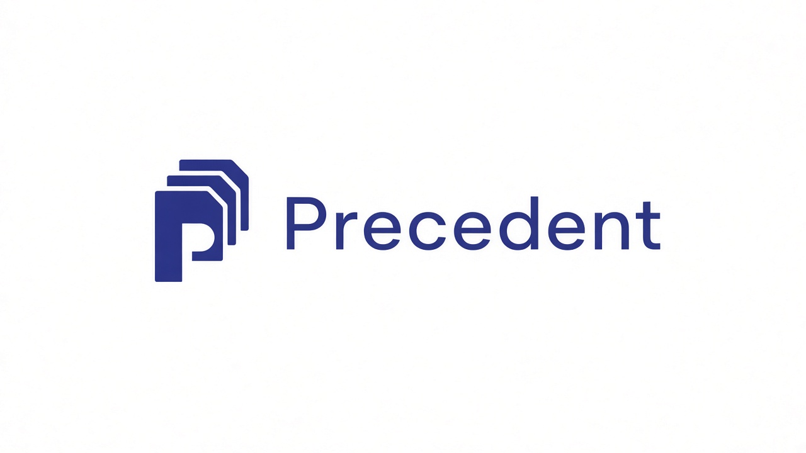

<p align="center">
  
</p>

# Precedent

**Effective policy for this path.**

Precedent is the company and the product. We compile the Cursor instructions in force for a repository, name which always-on statements conflict, and show that on the pull request.

We do not guarantee the model will comply. We compile what should win, then make policy drift visible.

Free for one person and one repo. No account. Team and Cloud come later.

## Product

| Surface | What it does |
| --- | --- |
| CLI | `npx @useprecedent/precedent` — Markdown report, or JSON |
| GitHub Action | Comments when a PR changes always-on policy. Optional fail-on-unresolved |
| Skill | Same compiler, for a local Cursor session |

Honest labels: **measured** is file inventory and documented precedence. **inferred** is semantic contradiction.

## Install

```bash
npx @useprecedent/precedent
```

```bash
npx @useprecedent/precedent --root . --json
npx @useprecedent/precedent --root . --inventory
```

Node 22+ is required for `npx`. The measured inventory is also a Python script with the same JSON:

```bash
python3 scripts/compile_instructions.py --root .
```

## What it sees

**Measured** (files on disk, documented precedence):

- `AGENTS.md` / `CLAUDE.md` (repo, nested, optional ancestors)
- `.cursor/rules/*.mdc` classified as always / glob / intelligent / manual
- `~/.cursor/rules` when `--user-rules` is on
- Symlinks marked `aliasOf` so a copy is not a second authority

**Not on disk** (pass with `--extra-rules`):

- Cursor team rules
- User rules stored only in Cursor settings

**Out of v1:** glob, intelligent, and manual rules; plugin skills.

## Precedence

1. Team over project over user
2. Higher-specificity `AGENTS.md` / `CLAUDE.md` wins in the same chain; nested files apply under `appliesUnder`
3. Always-on project rules and covering `AGENTS.md` / `CLAUDE.md` are one layer — disagreement is **unresolved**
4. Glob / intelligent / manual stay out of the merge unless a later version matches this task

Contradiction detection is **inferred**. Paraphrases of the same action are not a conflict.

## Sample report

CLI and the GitHub Action use the same Markdown schema.

```
# Precedent

**Subject:** practicelink/pl-cmp

## Provenance

- Event: pull_request
- Base: a1b2c3d (main)
- Head: e4f5g6h
- Compare: https://github.com/practicelink/pl-cmp/compare/a1b2c3d...e4f5g6h

## Scope

- Activation: always-on
- Compile path: `.`
- Sources: 9 compiled, 6 in force
- Out of this report: team rules; user rules stored in Cursor settings

## Findings

1. **who runs terminal commands** (`unresolved`, inferred)
   - statement: The agent runs terminal commands. (`AGENTS.md:3`)
   - statement: I (the user) WILL RUN ALL TERMINAL COMMANDS YOU WILL NOT. (`.cursor/rules/user-commands.mdc:4`)

9 sources compiled. Rules not stored in git are not included in this report.

<details>
<summary>Methodology</summary>
...
</details>
```

## GitHub Action

Comment-only by default. Optionally fail the check.

```yaml
name: Precedent
on:
  pull_request:
    paths:
      - "AGENTS.md"
      - "CLAUDE.md"
      - "**/AGENTS.md"
      - "**/CLAUDE.md"
      - ".cursor/rules/**"
jobs:
  compile:
    runs-on: ubuntu-latest
    permissions:
      contents: read
      pull-requests: write
    steps:
      - uses: actions/checkout@v7
        with:
          fetch-depth: 0
      - uses: useprecedent/precedent@v1.1
        with:
          fail-on-unresolved: false
```

## Company

Precedent sells **effective policy**, not tokens and not model obedience.

| Plan | Shape |
| --- | --- |
| Free | One person, one repo, no card. CLI, skill, Action |
| Team | Flat monthly, not per seat. Org scans, CI, dashboard |
| Enterprise | VPC, SSO, audit export, enforced golden policy |

Free-tier compiles run on the machine. Nothing is sent to a Precedent server. Semantic v1 is a local heuristic.

## Skill

See [SKILL.md](SKILL.md). Session-start compile is noisy — keep it opt-in.

## What it cannot see

- Team rules, unless you pass `--extra-rules` or paste them into chat for the skill
- Whether the model actually obeyed the effective policy
- Glob / intelligent / manual matches (v2)

## License

Apache-2.0. Copyright 2026 Precedent.
